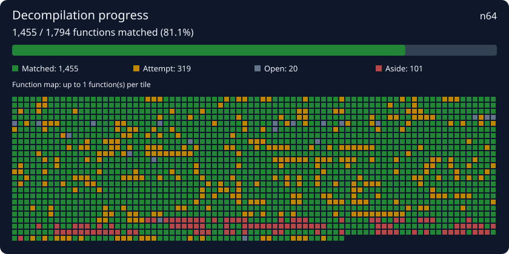

# TWINE (decompilation)

<!-- decompdecomp:details:start -->
- **Game:** TWINE
- **Platform:** n64
- **Compiler:** gcc-2.7.2-kmc
<!-- decompdecomp:details:end -->
<!-- decompdecomp:progress:start -->
- **Progress:** 1793 matching function(s), 65 best attempt(s)
- **Completion:** 1,793 / 1,793 functions (100.0%). 105 set aside, excluded from completion.
<!-- decompdecomp:progress:end -->
<!-- decompdecomp:visuals:start -->

Green: matched. Red: set aside or SDK.
<!-- decompdecomp:visuals:end -->

A matching decompilation of TWINE for the Nintendo 64, started with [decompdecomp](https://github.com/RetroReversing/decompdecomp).
`build.py` rebuilds the game from this tree and checks it against your original, byte for byte.

## Build

1. Put your own copy of the game here as `baserom.z64` (it is in `.gitignore`; never commit it).
2. `python3 build.py` (it uses decompdecomp's period compiler and assembler, so decompdecomp must be installed).

## Layout

| Path | What it is |
| :-- | :-- |
| `src/<segment>/<function>.c` | Decompiled functions, one per file, each matching the original. |
| `asm/nonmatchings/` | Assembly of every function (the target for the decompiled ones). |
| `asm/data/`, `asm/*.s`, `assets/` | Data, start-up code and binary parts, still as assembly or binary. |
| `include/common.h` | Types, structs and prototypes worked out so far. |
| `game.ld` | Places every function and data block at its original address. |
| `build.json`, `build.py` | How each file is built, and the build. |
| `objdiff.json` | Per-function units for [objdiff](https://github.com/encounter/objdiff) (`python3 build.py targets` makes their targets). |

Keep going with any tool: write a function in C under `src/`, add it to `build.json` (see the existing entries),
run `build.py`. When it says *identical*, the function matches. This is the base for ports and mods: once
everything is C, the game can be rebuilt, changed and moved to other platforms.

The game's code and data belong to their rights holder: keep this tree to yourself unless you have the right to
share it.

## Open in decompdecomp

Open this repository with **New project → Open a saved project** and supply your own game copy. The `progress/` folder retains matches, drafts, names, notes, headers and compiler settings. Build files and sources live at the repository root; ROMs and extracted files are excluded by `.gitignore`.
